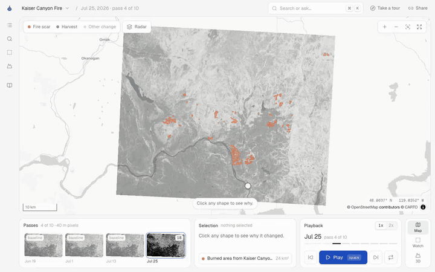
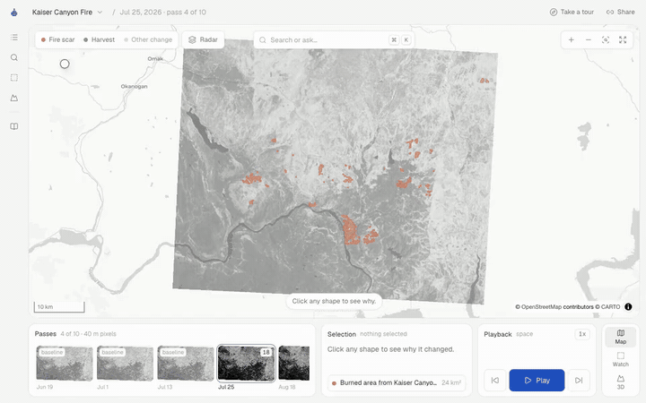
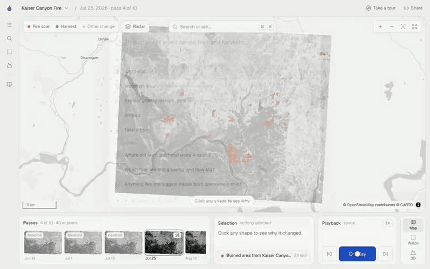
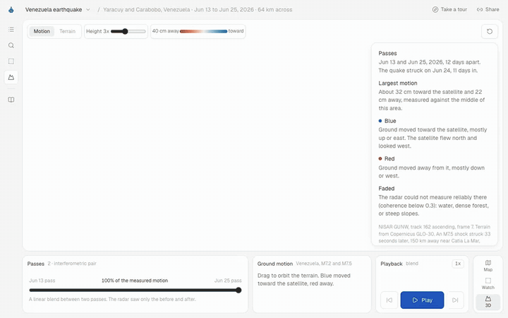

<div align="center">

# Distill

**Radar sees the ground through clouds. Distill makes it readable.**

A map of how Earth's surface is changing, built from NASA and ISRO's NISAR radar.
Every change has a start, a peak and a reason in plain words.

[](https://distill-khaki.vercel.app)
[](https://huggingface.co/datasets/amanibobo/nisar-surface-change-2026)
[](https://www.spaceappschallenge.org/2026/challenges/dancing-with-the-sars/)
[](https://nisar.jpl.nasa.gov/)
[](LICENSE)

</div>

<p align="center">
  
</p>

## What it does

- **Change as events.** Every NISAR pass is stacked into one block of place and time, so a fire or flood is one event with a start, a peak and an end.
- **Every change explains itself.** Type, confidence and the physical reason, written so anyone can follow.
- **Ask anything with ⌘K.** Claude answers by calling real tools over the events, and you watch each call stream in.
- **Find changes like this,** anywhere, by how the radar signal behaved.
- **Watch an area** and replay past passes as alerts. A daily job checks NASA's archive for new passes.
- **See the ground move in 3D** after five 2026 earthquakes.

<table>
  <tr>
    <td width="50%"><br /><sub>Click any change to see why.</sub></td>
    <td width="50%"><br /><sub>Ask in plain English with ⌘K.</sub></td>
  </tr>
  <tr>
    <td colspan="2"><br /><sub>Ground motion after the June 2026 earthquakes in Venezuela.</sub></td>
  </tr>
</table>

## Coverage

**7 radar sites, 1,410 change events, 75 NISAR passes**, plus **5 earthquakes** in 3D, all from June to November 2026.

| Site | Change | Reference | Precision | Recall |
| --- | --- | --- | --- | --- |
| Huelva wildfire, Spain | Fire scar | Copernicus EMS burned area | 0.81 | 0.92 |
| Viotia wildfires, Greece | Fire scar | Copernicus EMS burned area | 0.70 | 0.79 |
| Central Spain wildfires | Fire scar | Copernicus EMS burned area | 0.89 | 0.29 |
| Kaiser Canyon Fire, USA | Fire scar | NIFC fire perimeter | 0.88 | 0.26 |
| Central Iowa, USA | Harvest | USDA crop map | 0.91 | 0.93 |
| São Félix do Xingu, Brazil | Deforestation | INPE DETER alerts | 0.13* | 0.50* |
| Upper Assam, India | Flood | Sentinel-1 water | 0.19* | 0.05* |

<sub>* Rule written after looking at that site's reference, so not a blind check. Full scores, limits and every decision are in the <a href="https://distill-khaki.vercel.app/writeup">writeup</a> and <a href="docs/decisions.md">decisions.md</a>.</sub>

## Run it

```sh
cd pipeline
uv run python -m distill.fetch     # stream NISAR site windows from ASF (needs an Earthdata login)
uv run python -m distill.run       # detect, label, score, caption
uv run python -m distill.load      # load into Postgres + PostGIS
uv run python -m distill.embed     # signatures for find more like this
uv run python -m distill.dataset   # export the open dataset

cd ../web && pnpm install && pnpm dev
```

Needs `ANTHROPIC_API_KEY` and `DATABASE_URL` in `.env`. Without a database the app reads `pipeline/out/*.json`.

## Built with

NISAR L2 GCOV and GUNW via the ASF DAAC · ESA WorldCover · Copernicus EMS · Sentinel-1 · Python (asf_search, h5py, xarray, scikit-image, rasterio) · Next.js · MapLibre · react-three-fiber · Postgres, PostGIS and pgvector · Claude

<sub>Event titles, summaries and search answers are written by Claude from numbers the pipeline computed. Change types and confidence come from Distill's rules.</sub>
